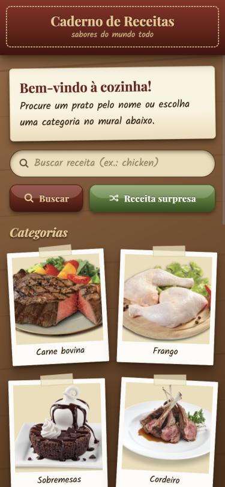
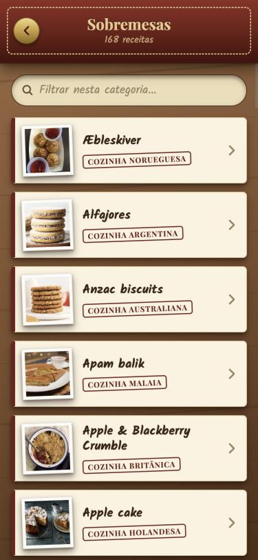
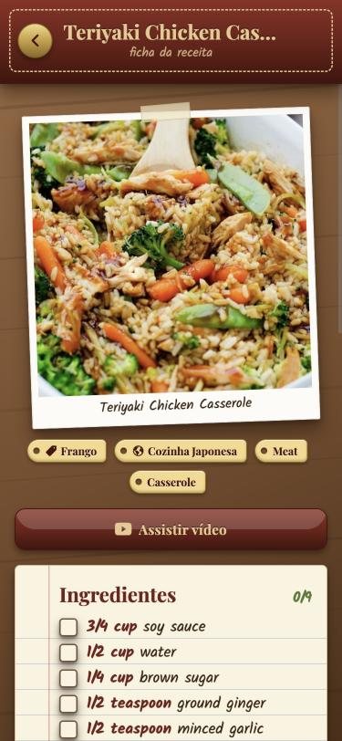
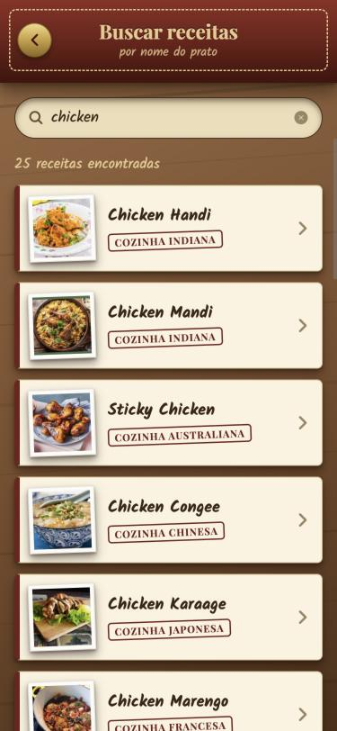
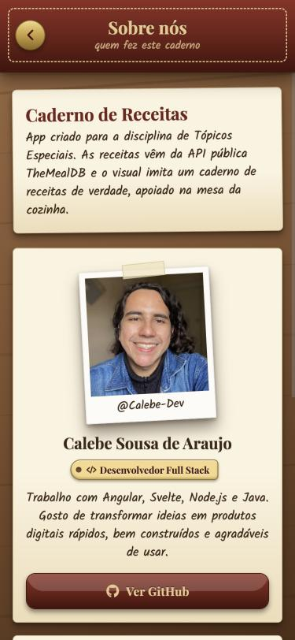
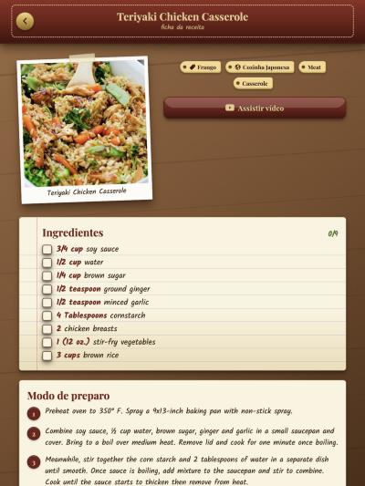

# Caderno de Receitas

Aplicativo mobile desenvolvido com **Expo + React Native** como trabalho prático da disciplina de Tópicos Especiais.

O app consome a API pública [TheMealDB](https://www.themealdb.com/api.php) e apresenta receitas do mundo todo como se fossem um caderno de receitas antigo apoiado sobre uma mesa de madeira. O visual segue a linguagem de design **skeumorfista**: texturas e materiais do mundo real (madeira, couro costurado, papel pautado, fotos reveladas presas com fita, etiquetas de latão) com relevo, sombras e botões que afundam ao serem pressionados.

## Integrantes

| Nome | GitHub |
| ---- | ------ |
| Calebe Sousa de Araujo | [@Calebe-Dev](https://github.com/Calebe-Dev) |
| Cleiton Valemtin | [@Cleiton-code](https://github.com/Cleiton-code) |

> **Observação:** todo o desenvolvimento foi feito pela mesma máquina, por isso os commits aparecem no nome de [@Calebe-Dev](https://github.com/Calebe-Dev).

## Telas

O app tem **5 telas**:

| Início (categorias) | Receitas da categoria | Ficha da receita | Busca | Sobre nós |
| :-----------------: | :-------------------: | :--------------: | :---: | :-------: |
|  |  |  |  |  |

1. **Início** — mural com as fotos das categorias (presas com fita), campo de busca e o botão **Receita surpresa**, que sorteia uma receita aleatória.
2. **Receitas da categoria** — fichas com foto, nome e carimbo da origem do prato, com filtro por nome dentro da categoria.
3. **Ficha da receita** — foto grande, etiquetas de latão (categoria, origem e tags), lista de ingredientes em papel pautado com caixinhas para marcar o que já foi separado, modo de preparo numerado e botões para o vídeo no YouTube e a receita original.
4. **Busca** — procura receitas pelo nome do prato enquanto o usuário digita.
5. **Sobre nós** — aberta pelo botão de latão no cabeçalho da tela inicial; apresenta o app e os integrantes da dupla, com foto, função, uma breve descrição e link para o GitHub de cada um.

Em telas largas (tablet e web) o conteúdo fica centralizado com largura máxima, o mural ganha mais colunas e a ficha da receita coloca foto e etiquetas lado a lado:



## API utilizada

[TheMealDB](https://www.themealdb.com/api.php) — API gratuita de receitas. Endpoints usados (`src/services/mealApi.js`):

| Endpoint | Uso no app |
| -------- | ---------- |
| `categories.php` | Lista de categorias da tela inicial |
| `filter.php?c={categoria}` | Receitas de uma categoria |
| `lookup.php?i={id}` | Detalhes de uma receita |
| `search.php?s={nome}` | Busca por nome |
| `random.php` | Receita surpresa |

A API só fornece textos em inglês; os nomes das categorias e das origens dos pratos são traduzidos para o português em `src/utils/translations.js`.

## Layout com Flexbox

Toda a interface é montada com Flexbox do React Native:

- **Mural de categorias:** `flexDirection: 'row'` + `flexWrap: 'wrap'`, com a largura de cada foto calculada pela largura da tela (2, 3 ou 4 colunas).
- **Fichas de receita:** linha com foto fixa, área de texto com `flex: 1` e seta no fim.
- **Cabeçalho:** três áreas em linha (botão de voltar, título com `flex: 1` e lado direito).
- **Botões de ação e etiquetas:** `flexWrap`, `flexGrow` e `flexBasis` para quebrarem de linha em telas estreitas.
- **Estados de carregamento e erro:** `justifyContent` e `alignItems` para centralizar o bilhete na tela.

## Skeumorfismo

| Elemento | Material imitado | Como foi feito |
| -------- | ---------------- | -------------- |
| Fundo | Mesa de madeira | Gradiente marrom + faixas finas inclinadas simulando os veios |
| Cabeçalho | Couro costurado | Gradiente vinho, borda tracejada como costura e título com efeito gravado (`textShadow`) |
| Cartões | Papel envelhecido | Gradiente creme, pautas azuis e margem vermelha de caderno |
| Fotos | Foto revelada | Moldura branca, leve rotação, sombra e pedaço de fita adesiva |
| Botões | Botões plásticos e de latão | Gradiente, brilho na metade superior e `boxShadow` interno que "afunda" ao pressionar |
| Campo de busca | Campo entalhado | Sombra interna (`inset`) |
| Etiquetas | Tags de latão | Furo, relevo e texto em alto relevo |

## Tecnologias

- [Expo](https://expo.dev/) e [React Native](https://reactnative.dev/)
- [React Navigation](https://reactnavigation.org/) (native stack)
- [expo-linear-gradient](https://docs.expo.dev/versions/latest/sdk/linear-gradient/)
- [@expo/vector-icons](https://icons.expo.fyi/)
- [Expo Google Fonts](https://github.com/expo/google-fonts) (Playfair Display e Kalam)

## Estrutura de pastas

```
├── App.js                  # Carrega as fontes e monta a navegação
├── assets/                 # Ícone e splash do app
├── docs/prints/            # Prints usados neste README
└── src/
    ├── assets/images/      # Fotos dos integrantes
    ├── components/         # Componentes reutilizáveis
    │   ├── CategoryTile.js     # Foto de categoria no mural
    │   ├── GlossyButton.js     # Botão em relevo com brilho
    │   ├── IngredientItem.js   # Ingrediente com caixinha para marcar
    │   ├── InsetField.js       # Campo de busca afundado
    │   ├── LeatherHeader.js    # Cabeçalho de couro e botão de latão
    │   ├── PaperCard.js        # Folha de papel (lisa ou pautada)
    │   ├── Polaroid.js         # Foto com moldura e fita adesiva
    │   ├── RecipeRow.js        # Ficha de receita nas listas
    │   ├── ScreenContainer.js  # Estrutura comum das telas
    │   ├── Stamp.js            # Etiqueta de latão
    │   ├── StatusMessage.js    # Carregando, erro e lista vazia
    │   └── WoodBackground.js   # Fundo de mesa de madeira
    ├── data/               # Dados dos integrantes (tela Sobre nós)
    ├── hooks/              # useApi (carregamento e erro das requisições)
    ├── navigation/         # Rotas (stack navigator)
    ├── screens/            # Home, Category, Recipe, Search e About
    ├── services/           # Acesso à API TheMealDB
    ├── theme/              # Cores, fontes e sombras
    └── utils/              # Traduções de categorias e origens
```

## Como rodar o projeto

Pré-requisitos: [Node.js](https://nodejs.org/) instalado e o app **Expo Go** no celular (ou um emulador Android/iOS).

```bash
# clonar o repositório
git clone https://github.com/Calebe-Dev/caderno-de-receitas.git
cd caderno-de-receitas

# instalar as dependências
npm install

# iniciar o servidor de desenvolvimento
npx expo start
```

Depois, escaneie o QR Code com o Expo Go (Android) ou com a câmera (iOS). Também é possível pressionar `a` para abrir no emulador Android, `i` para o simulador iOS ou `w` para abrir no navegador.
